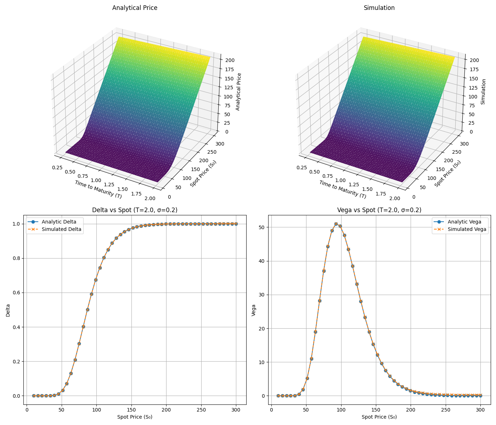
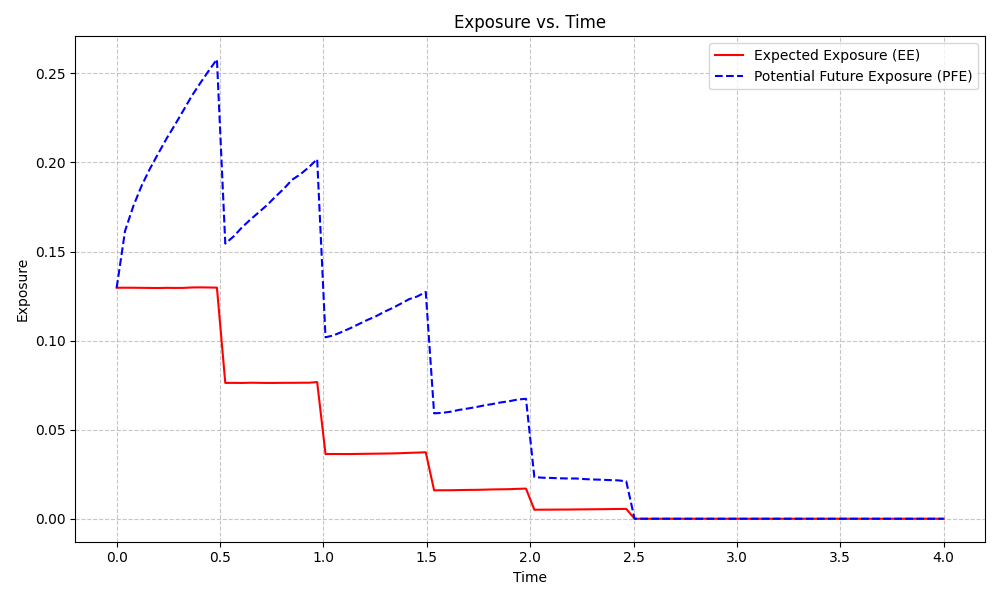
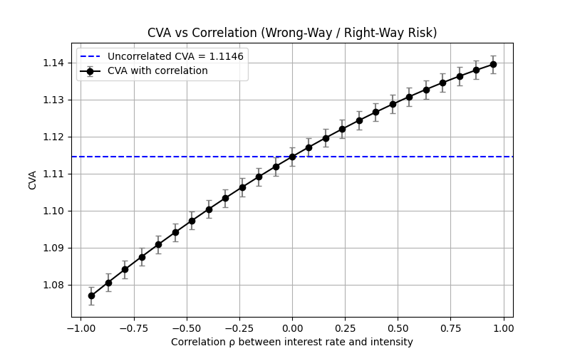
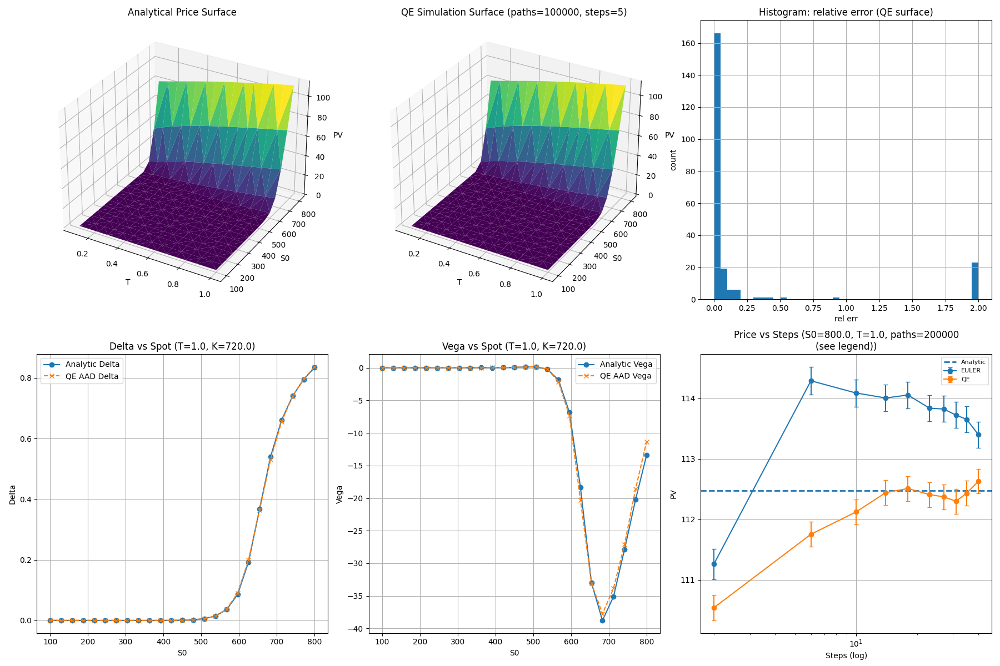

# Monte Carlo Simulation Engine

> A flexible, extensible Monte Carlo simulation engine for pricing and risk analytics of financial derivatives.  
> Copyright (c) 2025 Dr. Konstantin K. C. Eder

---

## Overview

This project provides a modular, high-performance Monte Carlo framework for **derivative pricing**, **exposure calculation**, and **xVA risk analytics**, built on top of **PyTorch** for CPU acceleration and adjoint algorithmic differentiation (AAD).

The engine supports equity, interest-rate, credit, and hybrid models, along with a wide range of financial products and risk metrics.

---

## Key Features

### Risk Metrics

- **PV** – Present Value  
- **CE** – Current Exposure  
- **EE / EPE** – (Effective) Expected Exposure  
- **ENE** – Expected Negative Exposure  
- **EEPE** – Effective Expected Positive Exposure  
- **PFE** – Potential Future Exposure  
- **xVA** – currently **CVA**, with extension points for DVA / FVA / MVA / KVA  

Metrics are available at the **product** and **netting-set** level, including collateralized exposure profiles with margin period of risk (MPoR) handling. Where closed-form evaluation is available for a given product/model pair, the engine can also use **analytical metric evaluation** instead of Monte Carlo.

### Sensitivities & AAD

- Efficient, scalable **adjoint algorithmic differentiation (AAD)** via [PyTorch](https://pytorch.org/)  
- **First- and second-order sensitivities** for supported products, including Hessian-style outputs from `SimulationResults`
- Payoff smoothing using fuzzy-logic techniques to enable AAD for discontinuous payoffs
  (binary options, barrier options, early-exercise structures)
- CPU-ready design for large-scale simulations

### Supported Products

- European equity & bond options  
- Bermudan equity & bond options  
- Bermudan swaptions  
- American options  
- FlexiCalls  
- Asian options  
- Binary options  
- Barrier options  
- Basket / multi-asset options  
- Interest rate swaps  
- Bonds: zero-coupon bonds, coupon bonds, floating-rate notes (FRNs)

### Stochastic Models

- **Equity**
  - Black–Scholes (single-asset)
  - Black–Scholes multi-asset
  - Heston Model
- **Interest Rates**
  - Vasicek
  - Hull–White
- **Commodity models**
  - Schwartz-Two-Factor
- **Credit**
  - Shifted Cox–Ingersoll–Ross (**CIR++**) with bootstrapped hazard curves from CDS spreads
- **Hybrid ModelConfig**
  - Configure multiple models jointly with a correlation structure to simulate hybrid risk factors  
    (e.g. Vasicek interest rates + CIR++ default intensities with wrong-way risk).

---

## Architecture

- **SimulationController**  
  Orchestrates Monte Carlo simulations, time stepping, and path generation.

- **ModelConfig**  
  Combines one or more stochastic models and an inter-asset correlation matrix.

- **Metrics API**  
  Pluggable interface for defining numerical and analytical metrics (PV, EE, PFE, CVA, …).

- **Exposure & Regression Engine**  
  Supports Longstaff–Schwartz regression for continuation values and exposure estimation.

- **Netting Sets & Collateralization**  
  Aggregates products into netting sets, supports collateralized and uncollateralized exposure calculations,
  and evaluates delayed collateral posting via MPoR-aware timelines.

- **Request/Response Interface**  
  Models expose quantities (discount factors, survival probabilities, forward rates, etc.) via
  a lightweight request abstraction, allowing flexible model coupling.

The design makes it easy to:

- add new models  
- add new products  
- define new metrics  
- extend to further xVA measures

---

## Example Results

### PV and Sensitivities for a European Option

Present value and corresponding sensitivities for various spots and maturities:



---

### Exposure Profiles

Expected and potential future exposure for a bermudan swaption:



---

### CVA vs Correlation – Payer Interest Rate Swap (WWR)

CVA of a payer interest rate swap as a function of the correlation ρ between the short rate (Vasicek)
and the default intensity (CIR++). Positive correlation between rates and intensity induces **wrong-way risk**, so CVA
**increases** with ρ. Negative correlation generates **right-way risk**. Error bars show Monte Carlo
standard errors.



---

### Heston Model – Calibration, Pricing, and Sensitivities

The Heston stochastic volatility model is calibrated to equity option data and used for pricing, risk, and convergence analysis.
- Pricing uses the Quadratic–Exponential (QE) scheme of Andersen (2007)
- Fuzzy-logic smoothing is applied at the QE branching threshold to ensure numerical stability and full compatibility with pathwise AAD
- Greeks (Delta, Vega) computed via AAD are validated against analytic finite differences
- Convergence of Euler vs QE is analyzed with Monte Carlo error bars



The QE scheme with fuzzy branching delivers accurate prices, stable sensitivities, and significantly faster convergence than Euler discretization, while remaining fully differentiable.


## Notebooks

Interactive **Jupyter Notebooks** are provided to demonstrate and explain key components of the Monte Carlo Engine.  
These notebooks serve both as **tutorials** and as **technical deep dives**, and are currently under development.

### Available Notebooks

#### **1. American & Bermudan Option Valuation**
- Illustration of regression-based continuation value estimation (Longstaff–Schwartz)
- Early-exercise regions visualized
- Comparison of:
  - Standard Monte Carlo
  - Least-Squares Monte Carlo (LSM)
  - Machine-learning–based approaches (e.g. Reinforcement Learning)
- Sensitivity analysis with adjoint differentiation

#### **2. Credit Derivatives & Basket CDS Pricing**
- Bootstrapping hazard rates from market CDS spreads
- Pricing of:
  - Single-name CDS
  - First-to-default and k-th-to-default basket CDS
- Copula-based dependency modeling:
  - Gaussian copula
  - t-copula
- Monte Carlo estimation of portfolio loss distribution
- CVA-style exposure profiles for credit instruments

### Additional Notebooks (Planned)
- Libor Market Model (LMM) simulation examples  
- Wrong-way risk analysis for swaps and structured credit  
- Exposure, EE/EPE/PFE profiles for various asset classes  
- Full xVA stack demonstration (CVA/DVA/FVA/MVA/KVA)

---

## Roadmap

- [x] Add credit derivatives (e.g. CDS, basket CDS)  
- [x] Add `ModelConfig` to configure and simulate several models simultaneously  
- [ ] Extend the request interface to support composite requests  
- [ ] Add **Libor Market Model (LMM)**  
- [ ] Add **Merton** jump-diffusion model  
- [x] Introduce netting sets and collateralization (CSA, margining)  
- [ ] Extend xVA stack (DVA, FVA, MVA, KVA)

---

## Installation & Quick Start

You can run **montecarlo-risk-engine** either:

- directly on your machine using Python, or  
- inside a **Docker container** (recommended for zero-configuration setup)

---

### 🔧 Option 1 — Local Installation (Python)

```bash
git clone https://github.com/konstantineder/montecarlo-risk-engine.git
cd montecarlo-risk-engine
python3.12 -m venv .venv
source .venv/bin/activate          # macOS/Linux
# or:
.\.venv\Scripts\activate           # Windows

pip install -r requirements.txt
```

### 🔧 Option 2 — Run with Docker (works out of the box)

```bash
docker build -t mcengine .
docker run -it mcengine python tests/pv_tests/pv_european_option.py
```

---

## TQQQ book

This fork prices the 13 Nov protective-put book with the engine's analytic Black-Scholes, then runs a daily-reset path. Put DTE and the horizon are separate. The default is a 180-day put marked over a 100-day path, so the put still has 80 days left at the end. Premiums are not the IBKR fill.

```bash
git pull
python3.12 -m venv .venv
.venv/bin/python -m pip install -r requirements.txt
chmod +x mcp/run.sh
PYTHONPATH=src .venv/bin/python -m tqqq_book --put-dte 180 --horizon 100 --paths 400 --seed 13 --report runs/tqqq-desk.html
```

Codex starts `mcp/run.sh`, which uses `.venv/bin/python` and not whatever `python3` is on `PATH`. Each run is saved under `runs/<id>/` with `summary.json`, `paths.jsonl`, and `desk.html`. The local MCP is [mcp/README.md](mcp/README.md). It is stdio only. Tools are `tqqq_book`, `tqqq_monte_carlo`, `tqqq_report`, `tqqq_runs`, and `tqqq_run`. Nothing is ordered.

The desk app's **Active runs** tab shows queued simulations, path progress, report-writing stages, and links to completed results. Runs continue when you change tabs or refresh the browser. The queue runs one job at a time and persists its history under `runs/.jobs/`. Pause finishes the current path and checkpoints it. Resume reuses completed paths; a failed in-progress path is recalculated from its saved inputs. Restarted apps expose interrupted jobs as paused, and queued jobs continue. Completed checkpoint data is removed once its final result is saved.

Open **Advanced configuration & parameter ranges** in Simulations or Configuration to set model and rule values and enable a parameter sweep. Each numeric setting, each of the four call OTM/contract values, and each put sleeve or ratio-grid component can have a start, end, and increment. In separate mode, a call OTM range from `0.2` to `0.5` by `0.1` produces four simulations. Adding a three-value range produces twelve simulations. The preview counts the full Cartesian product before launch; every combination must be valid, and a batch can contain at most 1,000 simulations. Save Configuration to reuse the values and ranges. Rule switches remain on the Rules tab.

Run desk tests with `cd desk-app && npm ci && npm test`. Python progress and configuration tests are in `tests/pytests/test_tqqq_book_desk.py`. The CLI's `--progress` option emits flushed `TQQQ_PROGRESS` JSON events; it leaves normal CLI output available. `RUNS_DIR` can isolate test results from the saved book.


The **Results for parameter ranges** selector stays visible beside the Run button when Advanced is collapsed and defaults to **One combined simulation**. Older saved separate-mode preferences are migrated once; explicitly choosing separate mode after this update is remembered. Six configurations with 100 paths each create one queued job, one saved run, and one P&L distribution containing 600 paths. Separate simulations remain available. Combined results include a per-configuration comparison, individual opening books and rules, and a path filter; each path records its configuration ID and full settings. JSON exports retain these settings, and the CSV zip adds `configurations.csv` plus a configuration column in `paths.csv`.

Combined statistics pool individual path outcomes, with each path counted once. They do not sum outcomes into a portfolio or average configuration percentiles. Configurations with the same seed share market shocks as in separate sweeps. When horizons vary, final P&L uses each path's own horizon and daily bands include only paths still active on that day. Opening book figures in the combined summary are weighted by each configuration's path count. Re-reading a combined run preserves its configurations and creates one combined result again.

Start or restart the web desk with `bash desk-app/up.sh`, or use `PORT=3001 bash desk-app/up.sh` for another port. The script requires Node, npm, and `lsof` (available on macOS; install it on Linux if needed). It installs missing dependencies from the lockfile and builds before stopping the current listener. It sends `TERM` only to processes listening on the selected TCP port, waits for release, then uses `KILL` if necessary. Repeated launches replace that listener and keep the desk in the foreground, so Ctrl+C stops it. A failed build leaves the existing server running. `RUNS_DIR` is preserved when supplied.

Completed separate batches in Active runs also offer **Combine completed results**, which creates one pooled result from their saved paths without simulating again. **Open combined results** then opens that view. Existing source runs remain available. Combined runs stream full trade histories to disk; their standalone HTML report previews the median path, while the desk app and JSON/CSV exports retain every path.

Open any path and choose **Optimize this path**, or use **Optimize weakest path versus stock** on a simulation. The optimizer searches bounded strategy ranges, optional rule switches, fixed/adaptive call policies, and strategy styles. Its default score is final P&L above holding the original shares; stock-only is an explicit candidate. It always includes the original strategy as a reference, keeps market assumptions and position size fixed, and caps a search at 1,000 candidates.

The results page ranks candidates and shows their P&L, excess over stock hold, drawdown and improvement. **Replay selected path** creates an inspectable saved path under a chosen candidate. **Apply to whole simulation** replays the same saved price sequences with that policy and reports the fitted path separately from all other paths. It does not redraw market prices. New runs save full-precision prices; legacy runs replay their recorded four-decimal daily prices. Fitting one path does not establish that the policy improves other paths; the paired replay is the next comparison.

**Save configuration** adds a durable learned strategy to the configuration library. **Use for new simulations** or the saved-strategy selector loads its strategy settings while preserving the simulation's market inputs. **Advanced → Dynamic call rules** enables the adaptive OTM policy: base OTM × (current IV / initial IV)^IV sensitivity, plus trend sensitivity × trailing price return and drawdown sensitivity × drawdown from the price peak, clipped to the configured bounds. Only information through the current day is used. The lookback and coefficients are editable and can be included in searches.

Combined simulations now have a ranking selector for mean P&L above stock hold, mean/median P&L, downside percentile, loss probability, drawdown and return on deployed capital. The table highlights the changing parameters and can filter paths by configuration. Pause and Resume are available for simulations, optimizer searches and replays; job manifests and atomic path checkpoints survive browser refreshes and application restarts.

Every path caps owned shares plus all open short-put contracts × 100 at the initial `lots × 100`. For 100 lots, this is 10,000 shares of total inventory, including potential put assignments. Called-away shares free room for reentry puts; extra protective long puts do not. The desk checks this limit at execution and credits only contracts it can actually sell. Assignments still settle in full.

Runs saved before the inventory-cap fix can contain inflated share counts and distorted P&L. Replay their saved market paths with the same configuration (or rerun) to calculate corrected results; existing saved results are retained. Resuming a pre-fix simulation, replay, or optimizer search recomputes its work under the corrected engine instead of mixing old checkpoints with new results. Subsequent pauses reuse the corrected checkpoints normally.
